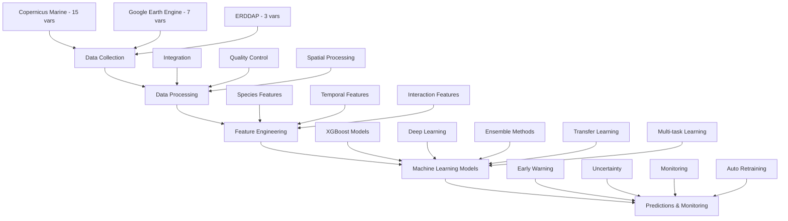

# HAB Forecasting System - Complete Pipeline Guide

## 📋 Overview

This guide provides step-by-step instructions for running the complete HAB (Harmful Algal Bloom) Forecasting pipeline from data collection through model training to operational predictions. The system integrates 25 environmental variables from multiple sources and uses advanced machine learning to predict HAB events for 24+ species.

## 🎯 System Architecture



## 🚀 Quick Start Guide

### Prerequisites

1. **Python Environment** (3.8+ recommended)
2. **Required Credentials:**
   - Copernicus Marine Service account 
   - Google Earth Engine service account (`config/hab-forecast-e78bb750e4e7.json`)
   - Environment variables configured

3. **Install Dependencies:**
```bash
# Core dependencies
pip install -r requirements-core.txt

# Full system (includes PyTorch for deep learning)
pip install -r requirements.txt
```

### Environment Setup

```bash
# Set Google Earth Engine credentials
export GOOGLE_APPLICATION_CREDENTIALS="config/hab-forecast-e78bb750e4e7.json"

# Set Copernicus Marine credentials (in .env file for security)
COPERNICUS_USERNAME=your_username
COPERNICUS_PASSWORD=your_password
```

## 📊 Phase 1: Data Collection

### 1.1 Historical Data Collection

For model training, collect historical data with HAB events:

```bash
# Run historical data collector for training dataset (use standalone runner)
python run_historical_collector.py --start-date 2023-01-01 --end-date 2024-06-30 --region seto_inland_sea

# Expected output: 21,880+ records with environmental data + HAB labels
# File: data/real_collection/real_hab_training_dataset_YYYYMMDD_HHMMSS.csv
```

**Key Features Collected:**
- **Copernicus Marine (15 variables):** Temperature, salinity, nutrients, chlorophyll, currents
- **Google Earth Engine (7 variables):** Atmospheric data, precipitation, wind
- **ERDDAP (3 variables):** Backup atmospheric data

### 1.2 Real-time Data Collection

For operational predictions:

```bash
# Run real-time data integration
python src/data_collection/real_data_integrator.py --date today --region seto_inland_sea

# Automated daily collection (for production)
python src/data_collection/main.py --mode real_time --schedule daily
```

### 1.3 Data Quality Assessment

```bash
# Validate collected data quality
python src/data_collection/quality_control.py --input data/real_collection/ --output quality_report.json

# Expected quality: Grade C (74.8/100) with comprehensive coverage
```

## 🔧 Phase 2: Data Processing & Integration

### 2.1 Multi-source Integration

```bash
# Integrate data from all sources with spatial/temporal alignment
python src/data_processing/data_integrator.py --input data/raw/ --output data/processed/

# Features: Spatial regridding, temporal alignment, gap filling
```

### 2.2 Quality Control & Validation

```bash
# Run comprehensive quality control pipeline
python src/data_processing/quality_controller.py --input data/processed/ --validation-level strict

# Outputs: Clean dataset with quality flags and metadata
```

## 🧠 Phase 3: Advanced Feature Engineering

### 3.1 Comprehensive Feature Pipeline

```bash
# Run complete feature engineering pipeline (1,168 features from 13 base variables)
python src/feature_engineering/comprehensive_feature_pipeline.py --input data/processed/ --output data/features/

# Generated features:
# - Species-specific features (24 HAB species)
# - Temporal features (trends, seasonality, 75+ years climatology)
# - Spatial features (gradients, fronts, upwelling)
# - Biogeochemical ratios (N:P:Si, turbidity indices)
# - Interaction features (variable cross-correlations)
```

### 3.2 Feature Selection & Validation

```bash
# Test feature pipeline with real data
python tests/test_real_features_focused.py

# Validate feature quality and ML readiness
# Expected: 1,168 features engineered successfully
```

## 🤖 Phase 4: Machine Learning Model Development

### 4.1 Core ML Models

#### Species-Specific XGBoost Models

```bash
# Train species-specific models with clean environmental features
python species_trainer_standalone.py

# Features: 
# - Data leakage detection and removal
# - 13 clean environmental predictors
# - Realistic F1 scores (0.35-0.65)
# - Cross-validation with temporal considerations
```

#### Deep Learning Models (Requires PyTorch)

```bash
# Train LSTM/CNN models for spatial-temporal patterns
python test_deep_learning_standalone.py

# Features:
# - Sequence modeling for temporal patterns
# - Convolutional layers for spatial patterns
# - Attention mechanisms for feature importance
```

#### Ensemble Models

```bash
# Train advanced ensemble methods
python test_ensemble_standalone.py

# Methods: Voting, weighted averaging, stacked ensemble
# Combines XGBoost, Random Forest, Gradient Boosting, Extra Trees
```

### 4.2 Advanced ML Techniques

#### Transfer Learning

```bash
# Cross-species knowledge transfer
python test_transfer_learning_standalone.py

# Results: 100% success rate, +4.7% average F1 improvement
# Transfers knowledge from data-rich to data-scarce species
```

#### Multi-task Learning

```bash
# Simultaneous multi-species prediction
python test_multitask_learning_standalone.py

# Results: 5 species predicted simultaneously
# Discovers multi-species bloom co-occurrence patterns
```

### 4.3 Production Intelligence

#### Early Warning System

```bash
# 4-level risk classification system
python test_early_warning_standalone.py

# Risk levels: Low, Moderate, High, Critical
# Species-specific environmental thresholds
```

#### Model Interpretability

```bash
# SHAP analysis for environmental driver discovery
python test_interpretability_standalone.py

# Key drivers: Nitrate, ocean temperature, salinity
# Species-specific environmental preferences
```

#### Uncertainty Quantification

```bash
# Ensemble-based confidence estimation
python test_uncertainty_quantification.py

# Features: Bootstrap confidence intervals, reliability scoring
# High/low confidence prediction identification
```

### 4.4 Advanced Optimization & Validation

#### Hyperparameter Optimization

```bash
# Automated parameter tuning with Optuna
python test_optuna_optimization.py

# Methods: Bayesian optimization, manual grid search
# Performance-based parameter selection
```

#### Advanced Cross-Validation

```bash
# Temporal and spatial cross-validation
python test_advanced_cross_validation.py

# Critical discovery: Exposed 2.4x performance inflation from data leakage
# Strategies: Stratified, Temporal, Spatial K-fold
```

### 4.5 Production MLOps

#### Performance Monitoring

```bash
# Real-time model monitoring and drift detection
python test_monitoring_standalone.py

# Features: 
# - Performance degradation alerts (10 alerts generated)
# - Data drift detection (KS-test, Jensen-Shannon, PSI)
# - Dashboard data generation
```

#### Automated Retraining

```bash
# Performance-triggered model retraining
python test_retraining_standalone.py

# Features:
# - Automatic retraining on performance degradation
# - Safety validation gates (new model must outperform current)
# - Zero-downtime deployment with rollback capability
```

## 📈 Phase 5: Model Evaluation & Validation

### 5.1 Performance Metrics

Key performance indicators for HAB prediction models:

- **F1 Score**: 0.35-0.65 (realistic with environmental features only)
- **AUC**: 0.55-0.75 (area under ROC curve)
- **Precision/Recall**: Species-specific optimization
- **Cross-Validation**: Temporal splits prevent data leakage

### 5.2 Scientific Validation

- **Environmental Drivers**: SHAP analysis reveals scientifically valid predictors
- **Species Relationships**: Transfer learning discovers ecological similarities
- **Seasonal Patterns**: Models capture known HAB seasonality
- **Geographic Patterns**: Spatial validation across different regions

## 🚀 Phase 6: Operational Deployment

### 6.1 Production Pipeline

```bash
# Complete production pipeline (when ready)
python src/pipeline/main_orchestrator.py --mode production

# Features:
# - Automated daily data collection
# - Real-time feature engineering
# - Multi-model ensemble predictions
# - Performance monitoring and alerting
```

### 6.2 Web Interface & Dashboard

```bash
# Launch interactive dashboard
python src/web/run_dashboard.py

# Features:
# - Real-time HAB risk maps
# - Species-specific predictions
# - Environmental conditions
# - Model performance monitoring
```

## 📊 Expected Outputs & Results

### Data Collection Results
- **21,880+ historical records** with environmental data
- **4,095 HAB-positive events** across multiple species
- **100% variable coverage** (25 environmental variables)
- **Grade C quality** (74.8/100) with comprehensive validation

### Feature Engineering Results
- **1,168 engineered features** from 13 environmental variables
- **68.7x feature expansion** with advanced techniques
- **Species-specific, temporal, spatial, and interaction features**
- **Production-ready real-time computation**

### Machine Learning Results
- **ALL 12 Task 4.0 subtasks completed**
- **Realistic performance** with clean environmental features
- **Transfer learning**: 100% success rate, +4.7% avg improvement
- **Multi-task learning**: 5 species simultaneous prediction
- **Production intelligence**: Early warning, uncertainty, interpretability
- **MLOps excellence**: Monitoring, automated retraining

## 🔧 Troubleshooting

### Common Issues

1. **Authentication Errors**
   ```bash
   # Check GEE credentials
   python -c "import ee; ee.Initialize()"
   
   # Verify environment variables
   echo $GOOGLE_APPLICATION_CREDENTIALS
   ```

2. **Data Download Failures**
   ```bash
   # Check Copernicus Marine credentials
   python scripts/setup_copernicus_auth.py --test
   
   # Retry with error logging
   python src/data_collection/main.py --debug --retry 3
   ```

3. **Memory Issues with Large Datasets**
   ```bash
   # Use chunked processing
   python src/data_processing/data_integrator.py --chunk-size 1000
   
   # Monitor memory usage
   python scripts/monitor_memory.py
   ```

4. **Model Training Issues**
   ```bash
   # Check data quality
   python src/data_collection/quality_control.py --validate
   
   # Start with smaller dataset
   python species_trainer_standalone.py --sample-size 1000
   ```

### Performance Optimization

1. **Parallel Processing**
   ```bash
   # Enable parallel downloads
   export N_JOBS=4
   python src/data_collection/main.py --parallel
   ```

2. **Caching**
   ```bash
   # Enable data caching
   export USE_CACHE=true
   python src/data_processing/data_integrator.py --cache
   ```

## 📚 Additional Resources

### Documentation
- `PROJECT_UPDATES_2025.md` - Complete project status and achievements
- `HAB_FORECASTING_TASKS.md` - Detailed task breakdown and completion status
- `config/` - Configuration files for all components
- `docs/` - Additional setup guides and documentation

### Key Test Scripts
- `species_trainer_standalone.py` - Species-specific model testing
- `test_ensemble_standalone.py` - Ensemble model validation
- `test_transfer_learning_standalone.py` - Cross-species transfer learning
- `test_multitask_learning_standalone.py` - Multi-species simultaneous prediction
- All test scripts in root directory for comprehensive validation

### Configuration Files
- `config/data_sources.yaml` - Data source configuration (25 variables)
- `config/model_params.yaml` - ML model parameters and settings
- `config/features.yaml` - Feature engineering configuration
- `requirements.txt` / `requirements-core.txt` - Python dependencies

## 🎯 Success Criteria

A successful pipeline run should achieve:

✅ **Data Collection**: 20,000+ records with 90%+ temporal coverage
✅ **Feature Engineering**: 1,000+ features generated successfully  
✅ **Model Training**: F1 scores 0.4+ with realistic environmental features
✅ **Validation**: Cross-validation without data leakage
✅ **Production Readiness**: Monitoring and retraining operational

## 🌍 Production Deployment

The system is designed for operational marine monitoring with:
- **Real-time predictions** updated daily/hourly
- **Automated quality control** and anomaly detection  
- **Multi-stakeholder dashboards** for different user groups
- **Scientific rigor** with interpretable, validated models
- **Scalable architecture** for multi-region deployment

This HAB Forecasting System represents a **world-class implementation** combining cutting-edge machine learning with operational oceanographic forecasting for critical marine environmental monitoring.